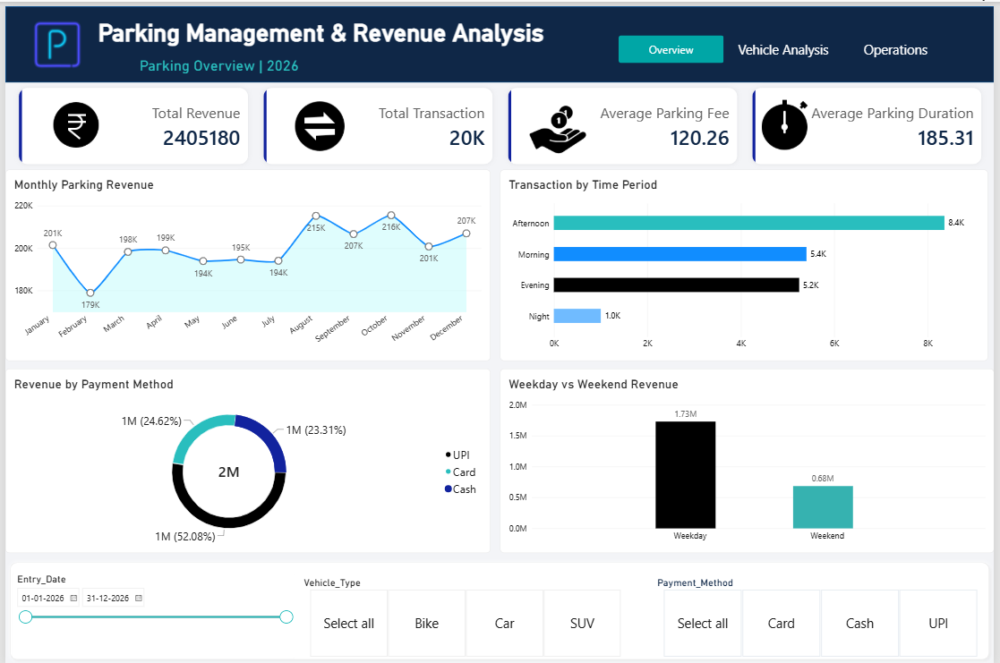
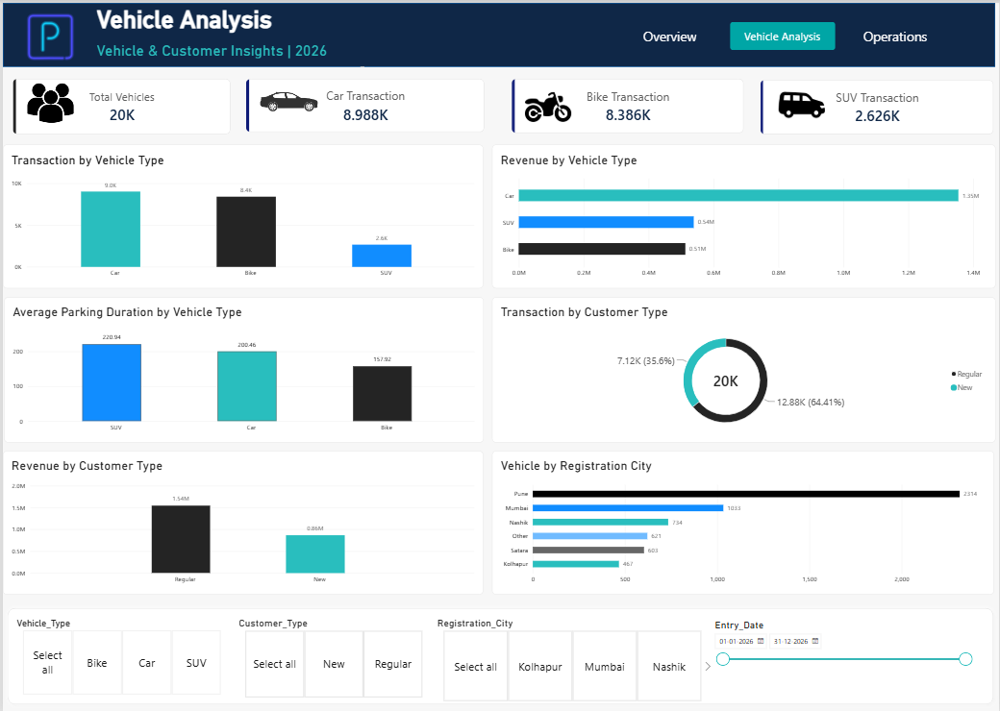
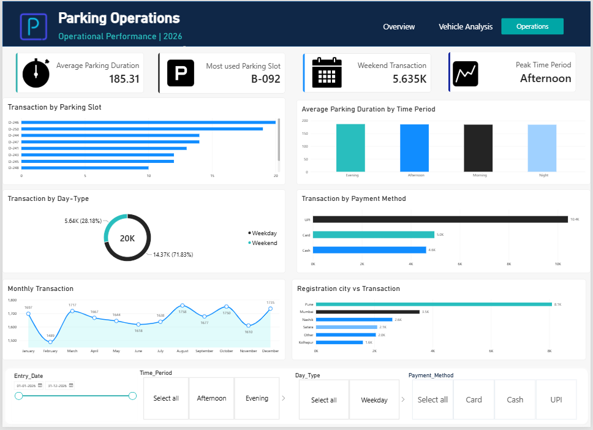

# Parking Analysis Project

## Project Overview

The Parking Analysis Project focuses on analyzing parking transactions, revenue, vehicle types, payment methods, parking duration, and operational patterns. The objective is to identify meaningful trends and present insights that support data-driven decision-making.

## Tools & Technologies

* **Excel:** Data preparation and analysis
* **MySQL:** Data querying and aggregation
* **Python:** Data analysis and exploration
* **Power BI:** Interactive dashboards and data visualization

## Project Objectives

* Analyze total parking revenue and transaction volume.
* Identify monthly revenue trends.
* Analyze transactions by vehicle type and payment method.
* Compare weekday and weekend parking activity.
* Understand parking duration and peak usage periods.
* Explore parking slot utilization and customer patterns.

## Dashboard Overview

### 1. Parking Overview

Displays key performance indicators, monthly parking revenue, transactions by time period, revenue by payment method, and weekday versus weekend revenue.

### 2. Vehicle Analysis

Analyzes revenue by vehicle type, average parking duration, customer type, and registration city.

### 3. Parking Operations

Provides insights into parking slot usage, parking duration by time period, transaction trends, payment methods, and registration city.

## Key Insights

* Total parking revenue: approximately ₹24.05 lakh.
* Total parking transactions: approximately 20,000.
* Average parking fee: approximately ₹120.26.
* Average parking duration: approximately 185.31 minutes.
* Afternoon was identified as the peak time period.
* August recorded the highest monthly revenue among the months analyzed.

## Business Recommendations

* Monitor peak-hour parking demand to support operational planning.
* Track monthly revenue to identify performance trends.
* Review payment-method preferences to improve customer convenience.
* Analyze frequently used parking slots to support better space management.
* Compare weekday and weekend activity when planning resources.

## Skills Demonstrated

Data Cleaning, Exploratory Data Analysis, SQL Queries, Python, Data Visualization, KPI Analysis, Power BI Dashboard Development, and Business Insights.

## Dashboard Screenshots

### 1. Parking Overview

### 2. Vehicle Analysis

### 3. Parking Operations

